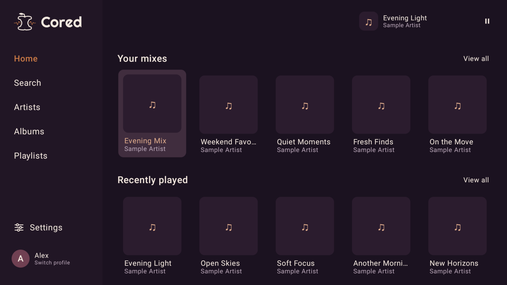
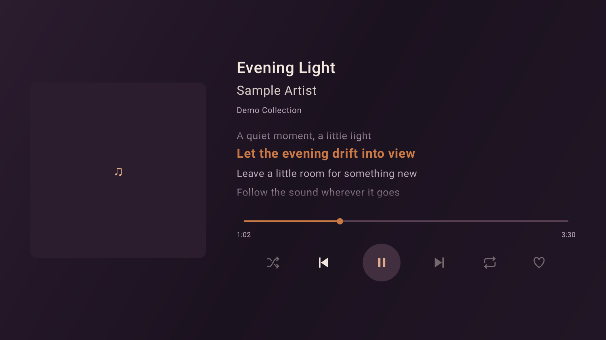
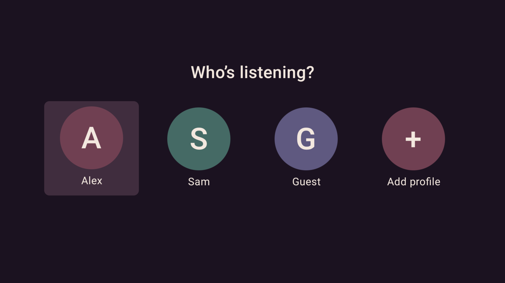

# Cored for the Nvidia Shield

Cored is a free Apple Music player for the Nvidia Shield, it's only been tested on the Shield 2019 Pro.

An active Apple Music subscription and an Nvidia Shield running Android 11 or later are required. Other devices have not been tested.

**[Download beta4](https://github.com/GroovyForge/package-distro/releases/tag/cored-v0.9.0-beta.4)**

## Would you use Cored?

Happy to sideload, interested in updates through the app, or waiting for Google Play? Vote in the poll to help me understand demand. You do not need to install Cored to take part.

**[Vote: Would you use Cored on your Nvidia Shield?](https://github.com/orgs/GroovyForge/discussions/1)**

## Screenshots

Captured on an Nvidia Shield using sample profiles and music details. Artwork is shown as placeholders.

### Home

| Now Playing | Profiles |
| --- | --- |
|  |  |

Select an image to view it at full size.

## Features

### Browse and listen

- Browse your Apple Music library, artists, albums and playlists.
- Search Apple Music and discover recommendations, charts and radio stations.
- Play albums and playlists, shuffle tracks and repeat your favourites.
- Keep listening with optional Autoplay when your queue ends.
- Mark songs, albums and playlists as favourites.
- Follow lyrics in Now Playing, with timed highlighting where available and an option to switch them off.

### Make it yours

- Create separate household profiles with their own Apple Music connections.
- Add an optional profile PIN.
- Choose a theme and start-up profile.
- Hold OK to reorder profiles or move Search, Artists, Albums and Playlists in the sidebar.
- Hide playlists from Cored without removing them from Apple Music.

### Apple Music sign-in

Choose either sign-in option:

- **QR code:** Scan with your phone, check that the code matches, authorize Apple Music, then confirm on the TV.
- **Password:** Sign in directly on the TV.

## Install

1. Open the [beta4 release](https://github.com/GroovyForge/package-distro/releases/tag/cored-v0.9.0-beta.4) and download the APK under **Assets**.
2. Transfer the APK to your Nvidia Shield and open it.
3. If Android asks, allow installation from the app you use to open the APK.
4. Open Cored, create a profile and sign in to Apple Music.

## Updates

Download the latest APK from this repository and install it over your existing copy of Cored. Keep Cored installed to preserve your profiles and settings.

In-app update checking is not available yet.

## Download checks

Releases include a signed APK, a SHA-256 checksum and a VirusTotal report. Compare your download with **SHA256SUMS** and review the scan linked from the release.

A clean scan cannot guarantee safety. Android also checks that an update uses the same signing identity as your installed copy.

## Why Cored is distributed here

I'm testing demand before committing to an app-store release. My main concern is protecting my family's privacy. I'm not comfortable publishing our home address on a store listing. Registering a business and using a business address add to the ongoing costs of maintaining Cored, including the Apple Developer subscription needed for Apple Music integration to continue functioning.

I started Cored because I wanted to play Apple Music directly on the Nvidia Shield without casting from my phone.

GitHub downloads let me gauge interest before taking on those extra costs. I understand that sideloading isn't for everyone, including people who would only use Cored through Google Play.

## Feedback

Cored is currently in beta. Report bugs through this repository, including your device, Cored version and steps to reproduce the problem.

Keep passwords, profile PINs, authorization tokens and sign-in QR links out of reports and screenshots.

[Privacy](https://groovyforge.co.uk/cored/privacy.html) | [Terms](https://groovyforge.co.uk/cored/terms.html)
